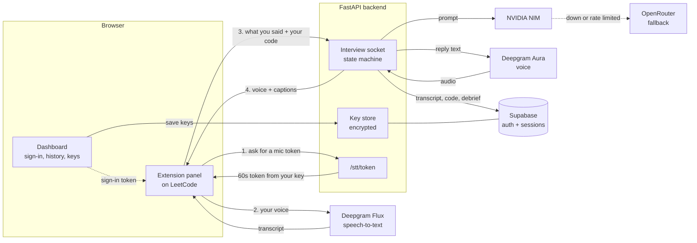

<div align="center">
  
  <h1>LeeView</h1>
  <p><b>A voice mock interview on any LeetCode problem.</b></p>
</div>

Open a LeetCode problem, click **Start interview**, and talk. An AI interviewer asks you to clarify the problem, explain your approach, write the code and walk through it, just like a real interview. When you finish you get a scored debrief, and every session is saved on your dashboard.

LeeView is open source and **bring your own keys**: you add your own NVIDIA NIM or OpenRouter key and a Deepgram key on your profile. Nobody pays for anyone else's usage.

## How it works



1. **Sign in** on the dashboard with Google. The extension picks up the session.
2. **Add your keys** on the Profile page. Keys are encrypted on the server (Fernet) before they reach Supabase, are only ever shown masked, and never reach the browser again.
3. **Speak.** The extension streams your mic straight to Deepgram Flux using a token that lasts 60 seconds. The backend mints that token from your Deepgram key, so the key never reaches the browser.
4. **The interviewer answers.** Each turn sends your words and the current editor code over one WebSocket. The backend moves the interview through its stages, asks the LLM, and streams the spoken reply back as audio. If NVIDIA NIM fails, the turn is retried on OpenRouter and NIM sits out for a minute.
5. **Debrief.** At the end the LLM scores approach, communication, correctness, code quality and time, and the dashboard shows it alongside the transcript and your code.

**Dropped connections resume.** If the socket drops (Wi-Fi blip, laptop sleep, server restart), the extension reconnects and the backend picks up where it stopped. It keeps a dropped interview for 45 seconds, and after a restart it rebuilds the session from Supabase.

## Repository

| Path | What it is |
| --- | --- |
| `app/extension` | Chrome extension (Manifest V3, React, Vite): the interview panel on LeetCode |
| `app/dashboard` | Web dashboard (React, Vite, Tailwind): sign-in, history, analytics, API keys |
| `app/backend` | FastAPI: interview socket, state machine, LLM and voice providers, key store |
| `supabase/migrations` | Database schema and row-level security, applied in order |

## Run it locally

You need Python 3.11+, Node 18+, a Supabase project, and keys from [Deepgram](https://console.deepgram.com) plus [NVIDIA NIM](https://build.nvidia.com) or [OpenRouter](https://openrouter.ai/settings/keys).

**1. Supabase.** Enable Google sign-in with `http://localhost:5173` as a redirect URL, then run every file in `supabase/migrations/` in order.

**2. Backend**

```bash
cd app/backend
python -m venv .venv && source .venv/bin/activate   # Windows: .venv\Scripts\activate
pip install -e ".[dev]"
cp .env.example .env    # fill it in; the comments explain each value
uvicorn main:app --app-dir src --reload --port 8000
```

Set `KEY_ENCRYPTION_KEY` (the command to generate one is in `.env.example`). Leave `ALLOW_SERVER_KEYS=false` to make every user bring their own keys. Set it to `true` on a private install to use the server's keys instead.

**3. Dashboard**

```bash
cd app/dashboard
npm install
cp .env.example .env    # Supabase URL + anon key, backend URL
npm run dev             # http://localhost:5173
```

**4. Extension**

```bash
cd app/extension
npm install
cp .env.example .env    # backend and dashboard URLs only: never put keys here
npm run build
```

Open `chrome://extensions`, turn on **Developer mode**, click **Load unpacked** and pick `app/extension/dist`.

**5. Try it.** Sign in on the dashboard, add your keys under **Profile → API keys**, then open any LeetCode problem and click **Start interview**.

## Tests

None of the tests call a real AI or voice API. Provider HTTP is scripted, so a full interview runs offline, covering the NIM-to-OpenRouter fallback, resume after a drop, and key handling.

```bash
cd app/backend && pytest -q
cd app/extension && npm test
```

## Launching

See [docs/launch-checklist.md](docs/launch-checklist.md).
